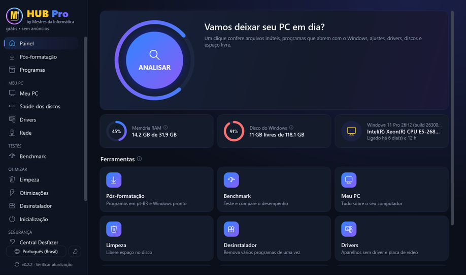
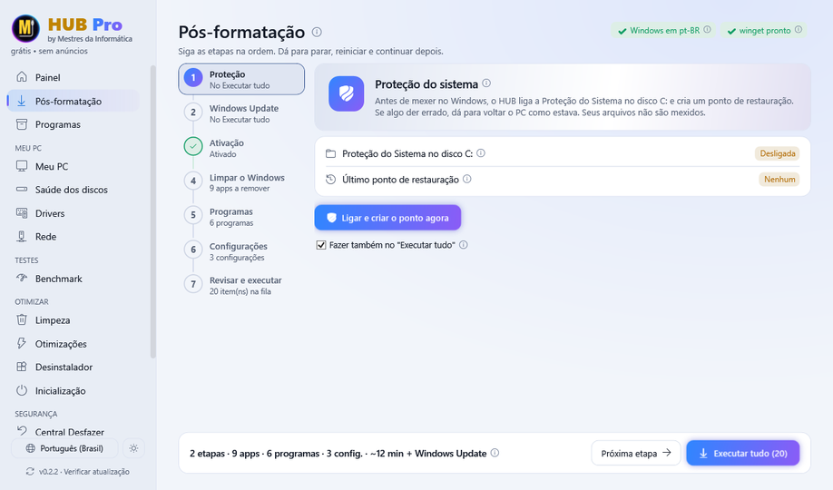

 

## 👋 Olá! Nós somos o Mestres da Informática

Um canal de tecnologia **descomplicada**: Windows, formatação, hardware, otimização e dicas para o dia a dia no PC, sempre em português, passo a passo e sem enrolação.

- 🪟 **Windows sem mistério:** instalar, formatar, atualizar, recuperar e deixar mais rápido.
- 🛠️ **Hardware na prática:** testes de peças, SSD, placa de vídeo, Wi-Fi e upgrades que valem a pena.
- 🛡️ **Segurança:** como fugir de golpes, vírus e programas que só atrapalham.
- 💸 **Economia:** ofertas garimpadas e o que realmente vale comprar.

---

## 🚀 HUB Pro: a central gratuita para cuidar do seu PC

O programa do canal, **grátis, sem anúncios e sem coleta de dados**. Tudo o que a gente ensina nos vídeos, num lugar só:

| Função | O que faz |
|---|---|
| 🚀 **Pós-formatação** | Ponto de restauração, Windows Update, ativação, remover propaganda, instalar seus programas e configurar o Windows, na ordem certa. |
| 📦 **Programas** | Instale e atualize os programas mais usados com um clique, direto do site oficial. |
| 🧹 **Limpeza e Otimizações** | Libere espaço e deixe o Windows mais leve. Tudo pode ser desfeito. |
| 🔌 **Drivers** | Windows Update, NVIDIA, AMD e Intel pelo instalador oficial, com a assinatura conferida. |
| 🗑️ **Desinstalador** | Remove vários programas de uma vez e procura as sobras. |
| 🌐 **Rede e 📊 Benchmark** | Descubra onde está o problema da internet e meça o desempenho do PC. |

---

## 📺 Os vídeos mais vistos do canal

<table>
  <tr>
    <td width="33%" align="center"> <b>PC ou Notebook Lento, Travando ou com Vírus? Faça uma LIMPEZA TOTAL no seu Windows</b></td>
    <td width="33%" align="center"> <b>Como Recuperar SENHA do Windows 11/10 SEM Programas</b></td>
    <td width="33%" align="center"> <b>Comprei o SSD de 30TB por R$75 da Shopee... Olha o que fizeram!</b></td>
  </tr>
  <tr>
    <td width="33%" align="center"> <b>PC TEM INTERNET MAS NÃO ACESSA DE FORMA ALGUMA (Resolvido)</b></td>
    <td width="33%" align="center"> <b>NUNCA Instale Esses Programas no Seu PC... JAMAIS!</b></td>
    <td width="33%" align="center"> <b>Como limpar TODO o CACHE e LIXO do Windows 11 e 10</b></td>
  </tr>
</table>

**[▶ Ver todos os vídeos no canal](https://www.youtube.com/c/mestresdainformatica)**

---

## 🔥 Ofertas e parceiros

| Onde | Detalhes |
|---|---|
| 💬 **Top Ofertas** | Promoções de peças, periféricos e eletrônicos garimpadas todo dia: [WhatsApp](https://whatsapp.com/channel/0029VaAgvjxGk1FmzFfBdZ0T) · [Telegram](https://t.me/topofertasmestresdainformatica) |
| 🛡️ **Kaspersky** | Antivírus recomendado pelo canal. Cupom **MESTRES**: 30% OFF no valor final. [Ver oferta](https://www.seguranca.gg/mestres/) |
| 🔑 **GVGMALL** | Chaves originais de Windows e Office. Cupom **GVGMD**. [Ver loja](https://www.gvgmall.com/) |

Alguns links podem gerar comissão para o canal, sem custo extra para você.

---

Feito com 💛 pelo <b>Mestres da Informática</b>. Se algum vídeo ou o HUB Pro te ajudou, deixe uma ⭐ no <a href="https://github.com/mestresdainformatica/HUB-Pro">HUB Pro</a> e inscreva-se no canal!

